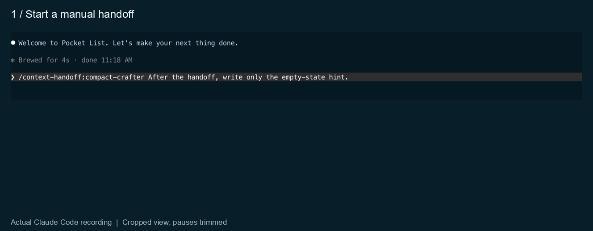

# context-handoff

Move a long interactive Claude Code session to a fresh context using a verified brief.

This plugin bundles the `/context-handoff:compact-crafter` skill, snapshot template and checker,
transcript extractor, and lifecycle relay. Track is optional. No separate global skill or
private source checkout is needed.

Tested on Claude Code 2.1.316 on macOS. Personal-account interactive checks and the fixture
suites are described below. Organization-managed policy compatibility is unverified;
this release makes no team-ready claim.

<picture>
  <source media="(prefers-reduced-motion: reduce)" srcset="assets/handoff-demo.png">
  
</picture>

Real manual handoff on Claude Code 2.1.317 with Haiku 5.5, using a fictional task and no Track.
The view is cropped and pauses are trimmed; the five-second countdown runs at its recorded speed.
[Watch the GIF](assets/handoff-demo.gif) · [View the still](assets/handoff-demo.png).

## Install and use

Requirements:

- A Claude Code runtime with the function-hook module API, ordinary command hooks, and
  `claude plugin test`. This is an experimental API; older plugin-only runtimes are insufficient.
- Python 3 for the bundled helpers.
- A POSIX host with `sh`, `bash`, and `date`.

Install once for your user from a terminal:

```sh
claude plugin marketplace add ohade/context-handoff
claude plugin install context-handoff@context-handoff --scope user
```

Restart Claude Code after installation. You can then run plain `claude` from any project
directory. The plugin loads automatically and uses the default 400,000-token threshold;
the handoff waits for a safe turn end.

You can also install inside Claude Code:

```text
/plugin marketplace add ohade/context-handoff
/plugin install context-handoff@context-handoff
```

Choose **Install for you (user scope)** in the plugin panel. In a new session, check `/help`
for `/context-handoff:compact-crafter`. Organization policy can restrict custom marketplaces;
installation does not establish managed-policy compatibility.

If you previously loaded another copy through `--plugin-dir` or your skills directory, use
one source for this plugin to avoid loading two copies.

To try the checkout for one session instead:

```sh
git clone https://github.com/ohade/context-handoff.git
cd context-handoff
claude --plugin-dir "$PWD"
```

For a manual handoff, type:

```text
/context-handoff:compact-crafter
```

The plugin also recognizes an explicitly typed legacy `/compact-crafter` request.
Automatic handoffs always select the namespaced command from this plugin.

Claude Code may generate SDK declarations under `.claude-plugin/types/`. They are ignored
development files and are not distributed with this repository.

## What happens

1. At the context threshold, the plugin asks the main agent to finish its current step and stop.
2. At a clean turn end, the bundled skill writes and checks a snapshot. The plugin adds
   transcript facts and verifies the complete brief.
3. A cancellable countdown appears. The default is five seconds.
4. The plugin clears the session and waits for a different session ID.
5. It replays the saved final response, restores Track when present, and sends the brief
   reference to the fresh session.

The previous response is placed in the fresh session's display. That display row does not
return after restarting Claude Code with `--resume`. The saved response text remains in
the handoff state and session history; the plugin does not place the row a second time.

A draft, pending typed input, active background work, an unknown lifecycle observation, failed
brief validation, or a refused final checkpoint prevents clearing. The automatic run has a
time limit and tool-call cap. It cannot run unrelated commands or use helpers from a global
skill installation.

The brief preserves pending user decisions, the unfinished objective, current work, identifiers,
and transcript-backed facts. Saved peer text and tool output remain data, not execution consent.

The manual built-in-compaction fallback also uses macOS `pbcopy` and `pbpaste` to copy its
prepared command. The main handoff path does not use clipboard commands.

## Optional Track integration

Without Track, pending decisions remain notes in the brief and have no verified tracker coverage.

With Track, the plugin uses the public checkpoint/restore v1 contract through tool calls. It
checks the source session, pending-row subjects, full notes and statuses before clearing.
In the destination session, it validates restoration counts, revision and checksums.
It does not read Track's private storage.

A present but incompatible Track, or a checkpoint refusal, stops the pre-clear handoff.
A restoration refusal after clearing holds continuation with the brief and recovery details.
Attempting a restore is not evidence of success.

## Configuration

Set options through Claude Code's `pluginConfigs["context-handoff"].options`, or set the
corresponding environment variables before launch. A valid environment value overrides the
option; an option overrides its default. Invalid values produce a warning.

| Option | Default | Range | Environment variable |
|---|---:|---|---|
| `thresholdTokens` | 400000 | 1–10000000 | `CONTEXT_HANDOFF_THRESHOLD_TOKENS` |
| `thresholdPercent` | unset | 1–99 | `CONTEXT_HANDOFF_THRESHOLD_PERCENT` |
| `minGrowthTokens` | 100000 | 0–10000000 | `CONTEXT_HANDOFF_MIN_GROWTH_TOKENS` |
| `maxAutoChain` | 2 | 0–20 | `CONTEXT_HANDOFF_MAX_AUTO_CHAIN` |
| `autoRunTimeoutSeconds` | 180 | 30–1800 | `CONTEXT_HANDOFF_AUTO_RUN_TIMEOUT_SECONDS` |
| `autoRunToolCap` | 15 | 1–100 | `CONTEXT_HANDOFF_AUTO_RUN_TOOL_CAP` |
| `ceilingTokens` | 500000 | 1–10000000 | `CONTEXT_HANDOFF_CEILING_TOKENS` |
| `nudgeTurnLimit` | 3 | 1–20 | `CONTEXT_HANDOFF_NUDGE_TURN_LIMIT` |
| `clearGraceSeconds` | 5 | 1–120 | `CONTEXT_HANDOFF_CLEAR_GRACE_SECONDS` |

A token threshold set in the environment wins over percent thresholds. Otherwise a valid
percent threshold replaces the token threshold. A token ceiling at or below the token threshold
becomes threshold + 100000. Background activity and user input still prevent clearing past
the ceiling. `maxAutoChain=0` disables automatic handoffs.

For a model whose context window is smaller than the default token threshold, set
`thresholdPercent` or `CONTEXT_HANDOFF_THRESHOLD_PERCENT`, for example `65`.

Useful environment controls:

- `CONTEXT_HANDOFF_DISABLE=1`: disable the plugin.
- `CONTEXT_HANDOFF_STATE_DIR`: override the state directory.
- `CONTEXT_HANDOFF_BRIEF_DIR`: override the snapshot and brief directory.
- `CONTEXT_HANDOFF_PLANNOTATOR_STORE_DIR`: override the optional review-store directory.

Default state and brief directories are resolved from the host's home directory under
`.claude/state/context-handoff` and `.claude/state/compact-handoffs`.
Logs and briefs can contain prompt text. Keep those runtime files private; none belong in this repository.

## Optional host conventions

The plugin can carry a matching pair of existing project markers and an existing unapproved
retro latch. It does not install the host's project hooks or retro helper. Retro integration
requires that host helper only when an existing latch needs to be carried; ordinary standalone
handoffs need neither. Public tests use synthetic marker states and do not certify an external
helper's implementation.

If another host hook emits a `CONTEXT COMPACT (` warning, the plugin can rewrite that message
to describe the handoff. That hook is optional and is not installed by this plugin.

## Recovery and limits

- Cancellation applies before clearing. After clearing, use the retained brief and visible
  recovery notice when restoration or continuation cannot be confirmed.
- An uncertain response append or seed delivery is not retried automatically. Check the
  destination session before retrying to avoid duplication.
- A single long turn may reach built-in compaction before a clean handoff point.
- Pending-decision checks validate declared records; they cannot prove that the model found
  every obligation in the conversation.
- Routing tests use representative synthetic policies. They do not certify every host policy.
- Managed settings, permissions, runtime upgrades, and optional integrations require separate
  interactive acceptance. Engine fixtures alone do not establish that acceptance.

## Development checks

Development checks additionally need Bun and pytest. Run from the plugin root:

```sh
bun test tests/pure
claude plugin test .
PYTHONDONTWRITEBYTECODE=1 python3 -m unittest discover -s tests/helpers -p 'test_*.py'
python3 -m pytest skills/compact-crafter/tests
python3 -m pytest scripts/tests
```

The engine suite uses fixtures: command dispatch and lifecycle events are controlled by the
test kit. Fresh interactive handoffs must separately verify the packaged command source,
session transition, response replay, continuation, cancellation, and optional Track restoration.

## Verification versions

The fixture suites were run on macOS with these runtimes:

| Runtime | Version | Check |
|---|---|---|
| Claude Code | 2.1.316, 2.1.317 | 243 engine fixture tests |
| Bun | 1.3.6 | 716 pure tests |
| Python | 3.12.8 | Six helper unittest tests and the pytest suites |
| pytest | 9.1.1 | 80 skill/helper and synthetic extractor tests |

The table describes fixture checks. Interactive results are separate and have the limits below.

Catalog validation and user-scope installation were also checked on Claude Code 2.1.317.
The installed plugin remained enabled when listed from a different working directory.

Native validation on Claude Code 2.1.316 has passed manual and automatic handoffs without
Track. Both selected the packaged skill, entered a different
session, visibly replayed the saved response, and continued the synthetic objective.
The manual case replayed a complete 3,603-character response. Reads of packaged files and
briefs used one-time host permission decisions. Fresh automatic cases also passed with
installed Track and a development refactor build: their full saved rows, paused notes,
deferred questions, and answers survived restoration, and their final continuation matched
the requested format. Those cases used a personal account with an empty policy layer.
Typed-input cancellation, the actual Cancel button (activated by keyboard), and a refused final
Track checkpoint also passed: the original session and full existing Track rows remained.
Those safety checks used a separate instrumented test copy and do not certify timing.
Organization-managed policy compatibility has not been verified. Do not treat the personal
account results as a team-ready claim or as acceptance for other runtime builds.

## License

Original context-handoff code is licensed under [MIT](LICENSE). See
[THIRD_PARTY_NOTICES.md](THIRD_PARTY_NOTICES.md) for the Apache-2.0 example attribution and
included upstream license.
